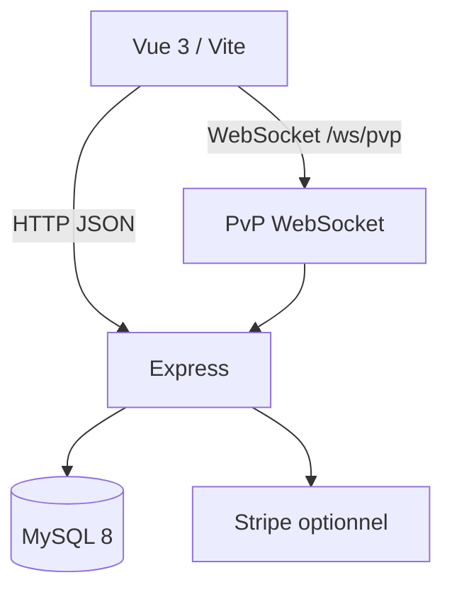

# Architecture

## Vue d'ensemble

## Backend

Point d'entrée : `backend/src/index.js`.

- charge les fichiers `.env` ;
- démarre Express ;
- attache `/ws/pvp` ;
- lance le scheduler si activé ;
- gère l'arrêt propre.

Montage HTTP : `backend/src/app.js`.

Domaines exposés :

- santé et authentification ;
- personnage ;
- cartes et collection ;
- decks et talents ;
- combat et missions ;
- Battle Pass et succès ;
- boutique et Stripe ;
- PvP ;
- factions, classement et administration.

### Organisation

| Dossier | Rôle |
|---|---|
| `backend/src/routes/` | Endpoints HTTP et validation minimale |
| `backend/src/services/` | Logique métier et orchestration |
| `backend/src/services/deckCombat/` | Moteur de combat PvE, cartes, statuts, boss et simulation |
| `backend/src/services/pvp/` | Matchmaking, bootstrap, matchmaking, résultats et sessions host |
| `backend/src/config/` | DB, économie, combat, catalogue starter |
| `backend/src/validators/` | Validation Zod des entrées |
| `backend/scripts/` | Seeds, tests, audits et simulations |
| `shared/pvp/` | Moteur de duel et utilitaires partagés frontend/backend |
| `backend/schema.sql` | Schéma initial et données de missions |

Les données de catalogue sont définies dans `backend/scripts/seedCards.js`, `backend/scripts/data/` et `backend/src/config/`. La base reçoit ces données par seed ; le schéma seul ne représente pas tout le catalogue runtime.

## Frontend

Point d'entrée : `frontend/src/main.js`.

- Vue 3 ;
- Pinia pour les stores ;
- Vue Router ;
- vue-i18n ;
- composants par domaine dans `frontend/src/components/` ;
- écrans dans `frontend/src/views/` ;
- règles affichées dans `frontend/src/content/`.

Écrans principaux : hub, création/profil, collection, deck builder, talents, missions, combat, boutique, Battle Pass, journal, PvP, classement et administration.

## Données et règles

Les cartes sont sérialisées depuis les définitions DB, puis converties en cartes runtime lors de la construction du deck. Le runtime conserve notamment : coût, chiffres, effets, `heldEffect`, améliorations, passifs et identité de voie.

Le moteur PvE résout les cartes côté serveur. Le PvP est différent : le serveur gère le match, mais le client Host exécute `shared/pvp/duelEngine.js`. Voir [PvP](PVP.md).

## Authentification

L'API utilise une session en cookie HTTP-only (`kage_session`). Les endpoints protégés passent par `attachUser` et les garde-fous de route. Le fallback compte de démonstration ne doit être activé que volontairement hors production normale.

## Persistance de combat

Une session PvE conserve séparément :

- état public du joueur ;
- état de l'ennemi ;
- phase et tour ;
- snapshot de stats ;
- effets de talents ;
- récompenses une fois le combat terminé.

Les modificateurs temporaires, dont réduction de la prochaine carte et suivi de combo, font partie de cet état sérialisé.

## Frontières importantes

- Aucun ancien système d'escouade ou cycle de 72 h n'est monté dans `app.js`.
- `specs/` contient de la conception, pas une preuve d'implémentation.
- Les seeds et contrôles de catalogue sont plus fiables qu'une liste manuelle dans une documentation.
- Une migration incrémentale n'est pas prise en charge : les changements structurants du schéma demandent une base reconstruite ou une opération SQL indépendante et revue.
