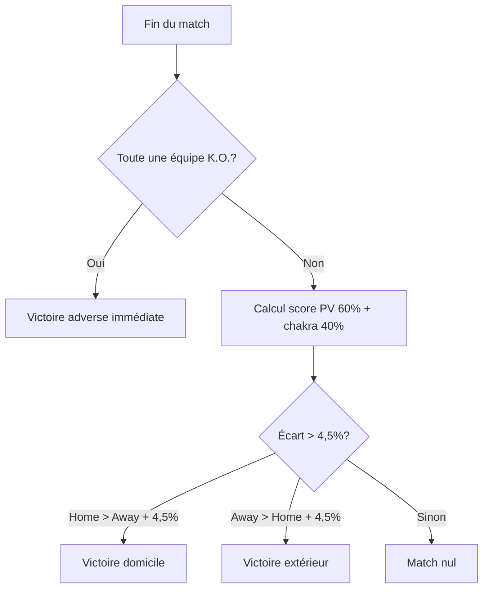

# Kage Legacy — Référence fonctionnelle (brainstorm)

Document orienté **joueur / game design**, sans architecture technique. Base pour brainstormer de nouvelles fonctionnalités. À mettre à jour au fil de l’évolution du jeu.

---

## Vision en une phrase

Manager shinobi asynchrone : vous êtes un **Jonin-Sensei**, vous gérez une escouade de jeunes ninjas sur des **cycles de 72 h** (temps réel), avec économie, progression, missions idle et **match de ligue** simulé chaque cycle.

---

## 1. Le cycle de 72 heures

| Phase | Heures | Ce que fait le joueur |
|--------|--------|------------------------|
| **Préparation** | H0 → H35 | Escouade, tactiques, entraînement, missions, magasin, Académie (jusqu’à H12), **mission de reconnaissance (H0–H36)** |
| **Milieu de cycle** | H36 → H70 | Tendances adverses, rapport d'espionnage, gestion continue |
| **Opération** | H71 | Match de ligue simulé ; chronique narrative dévoilée progressivement |
| **Clôture** | H72 | Examens Chunin, Vol d'Oiseau, missions, salaires, stagnation, entraînement, nouveau cycle |

**À partir de H71**, tout est gelé : composition, consignes de combat, entraînement, missions, dispensaire, marché P2P.

**Jalons automatiques :** mission de reconnaissance H0→H36 ; tendances H36 ; gel compo + rapport espionnage H54 ; simulation ligue H71 ; clôture H72 (examens Chunin, Vol d'Oiseau, entraînement).

---

## 2. Votre identité : le Sensei

- Monnaie : **Ryos**
- **Réputation** (Vol d’Oiseau, prestige)
- **Pool de chakra de match** (~100) : permet d’intercepter des coups fatals (−25 chakra par sauvetage)
- **Identité** (nom Sensei, cosmétiques Pack Élite) — pas de spécialité à choisir à la création
- **Dette** (Ryos < 0) : bloque magasin, marché, examen, dispensaire

**Compte invité** : essai 7 jours, conversion possible en compte permanent.

---

## 3. Les ninjas

### Grades et plafonds

| Grade | Plafond stats combat | Vitesse / QI max |
|-------|----------------------|------------------|
| Genin | 12 | 10 |
| Chunin | 18 | 16 |
| Jonin | 20 | 20 |

### Six stats

- **Combat** : Taijutsu, Ninjutsu, Genjutsu, Médecine
- **Support** : Vitesse, Intelligence (QI)

**En match :** PV max = Taijutsu × 10 (après Forme) ; Chakra max = base du grade + Ninjutsu × 2.

### Forme hebdomadaire

| Forme | Effet sur toutes les stats |
|-------|----------------------------|
| Divin | +15 % |
| Excellent | +5 % |
| Passable | neutre |
| Lamentable | −25 % |

Après un match : les K.O. descendent d’un palier. À H72, PV et chakra sont restaurés à 100 %.

### Traits de caractère

| Trait | Comportement |
|-------|--------------|
| **Égoïste** | +2 attaque si alliés ont moins de PV ; ignore le ciblage Tank |
| **Altruiste** | 50 % de chances d’encaisser un coup fatal à la place d’un allié |
| **Fainéant** | Immunisé au 1er Genjutsu ; 15 % de rater l’entraînement |
| **Téméraire** | +4 Vitesse tour 1 ; coût chakra 12 au lieu de 10 |
| **Discipliné** | Standard, sans surprise |

### Éléments

Cercle : **Katon > Futon > Doton > Raiton > Suiton > Katon**

- Avantage : dégâts ×1,25
- Désavantage : ×0,85

### Clans / lignées

7 lignées : Roturier, Nara, Uchiwa, Hyuga, Sarutobi, Akimichi, Yamanaka.

Recrutement pondéré : roturier 65 %, clan commun 25 %, noble 10 %.

Chaque clan oriente stats et voie dominante (ex. Hyuga → Taijutsu).

### Potentiel à la génération

Ordinaire (+6 pts) 55 % · Prometteur (+9) 35 % · Prodige (+12) 10 %.

### Âge (15–18 ans)

Coefficient d’entraînement : 15 ans ×1,5 · 16 ×1,0 · 17 ×0,7 · 18 ×0,4.

### Moral (1–20)

Pénalités : échec examen Chunin (−5), faillite salariale (moral escouade active ×0,8), stagnation (−3), achat ninja sur marché (−3).

---

## 4. Escouade

- **3 actifs** (postes 1–3) + **banc** (remplaçants)
- Modifiable jusqu’à H71
- Bloqué si ninja en mission, en vente P2P, ou fenêtre fermée

### Consignes individuelles

| Consigne | Rôle |
|----------|------|
| **Normal** | Attaquant tiré au sort |
| **Offensive** | Priorité attaque (meilleure stat combat) |
| **Défensive** | ~70 % de chances d’être ciblé en défense (ex-Tank) |
| **Protection** | Peut soigner un allié désigné sous 50 % PV (ex-Protect) |

### Dossier d'opération

Postures **Équilibrée / Offensive / Défensive / Protection** : plan de cycle + conseils (pas de bonus combat). Voir règles joueur §4.

### Cartes tactiques

Remplacent le cercle Assaut/Mur/Flux. 3 charges, 1 proc/match/ninja, synergie avec consignes.

---

## 5. Progression des grades

### Départ

6 ninjas : 1 Chunin actif (poste central) + 5 Genin (2 actifs, 3 au banc). Chaque trait représenté une fois.

### Examen Chunin (inscription avant H72, résolution H72)

- Prérequis : **note moyenne globale** ≥ 8
- Inscription : **gratuite**
- Réussite : prime 300–1 000 Ryos, +1 à +5 réputation, objet, forme +1 palier, moral +2 à +5
- Échec → moral −5

### Vol d’Oiseau (Chunin → départ, H72)

- Prérequis : **note moyenne globale** ≥ 14
- Prime : 3000 + (somme des 6 stats) × 150 Ryos + réputation
- Le Chunin part ; un **Genin roturier** de remplacement arrive (forme Excellent, moral 20)
- Laisse un **Parchemin mural d'héritage** (bonus permanent selon stat dominante, cumulable avec plafond)

### Stagnation (H72)

Genin éligible Chunin non inscrit, ou Chunin éligible Vol d'Oiseau non inscrit → **1 cycle de grâce**, puis forme −1 palier, moral −3.

---

## 5bis. Entraînement

| Levier | Coef / ninja | Coût | Cible |
|--------|--------------|------|-------|
| **Préparation** | 0,4 | Ryos (actifs) | 3 titulaires, type individuel |
| **Global** | 0,2 | Gratuit | 6 ninjas, 1 type commun |

**Types :** Chakra · Physique · Medical · Genjutsu · Ninjutsu · Equilibre.

**Potentiel :** ordinaire ×1 · prometteur ×1,1 · prodige ×1,25. Capital de stat avec variance RNG légère.

**Rythme cible :** ~5 cycles (ordinaire) · ~2–3 (prodige) pour Chunin avec prep + global alignés.

Spec détaillée : [`specs/training-system.md`](../specs/training-system.md).

---

## 6. Missions idle (contrats)

- Réservées aux ninjas **au banc**
- **1 contrat par palier de danger par cycle**
- Résolution H72, collecte manuelle des récompenses

| Palier | Ryos | Risques | Prérequis |
|--------|------|---------|-----------|
| **Routine** | 300–500 | Aucun | Tous |
| **Infiltration** | 600–800 | 20 % blessure légère | QI ≥ 8 ou Vitesse ≥ 8 |
| **Cyclone** | 1000 | 40 % grave, 5 % mort | Une stat combat ≥ 12 |

Blessure **grave** : Lamentable + 2 cycles sans soin dispensaire. **Mort** : ninja supprimé.

Butin possible : pansements, kits, fumigènes, parchemins, parfois prodige ou scroll de stat.

---

## 7. Économie

### Revenus principaux

| Source | Montant |
|--------|---------|
| Victoire ligue | 1 600 Ryos (+ butin bonus : Ryos, objet, carte) |
| Nul ligue | 800 Ryos (+ butin bonus) |
| Défaite ligue | 100 Ryos consolation (+ butin bonus) |
| Missions | 300–1000 |
| Vol d’Oiseau | 3000 + stats×150 |

### Dépenses principales

- **Salaires H72** (escouade active uniquement)
- **Préparation H72** (actifs, payante si Ryos suffisants)
- **Entraînement global H72** (toute l'équipe, gratuit)
- Examen Chunin, dispensaire, Académie, magasin, marché P2P

### Objets (3 types)

- **Bureau** : usage immédiat (soins forme, carte secteur, scroll…)
- **Match** : 1 slot/ninja, consommé en match si déclenché (fumigène, herbes, cachet chakra…)
- **Cycle** : effet sur tout le cycle (cape anti-pluie, ration salaire…)

### Marché P2P

- Vente ninjas au banc ou objets non équipés
- Max 3 annonces actives
- Commission 5 % (10 % pour nobles)
- Fermé H71+

---

## 8. Académie et magasin

**Académie rotative** : **3 aspirants Genin** visibles en permanence au Bureau. Toutes les **24 h (UTC)**, l'aspirant le plus ancien expire ; les deux autres glissent ; un nouveau apparaît. Recrutement possible tant que l'opération n'est pas gelée (H71+). Le **Sceau d'Or** (jackpot du Sceau de Chakra quotidien) force le prochain aspirant en **Prodige** ou **lignée Noble**.

**Sceau de Chakra (rituel quotidien)** : 1 sceau gratuit/jour (minuit UTC), stock max **3**. Ouverture au Bureau — butin de base (Ryos + objet aléatoire + chance de carte) puis palier 70 % commun / 20 % rare / 9 % épique (moral) / 1 % jackpot (Sceau d'Or Académie).

**Magasin** : stock personnel, réassort tous les 3 cycles de ligue, 2 promos −20 % par cycle.

---

## 8bis. Clans joueurs (coopération)

Hub **sans bonus de combat** — max **12 Senseis** par clan.

### Tableau d'affichage Académie
- **1 recommandation / cycle** : copier un aspirant de votre vitrine sur le tableau du clan
- Visible jusqu'à expiration (rotation 24 h)
- Les alliés recrutent avec **leurs propres Ryos**

### Puits de Chakra collectif
- Chaque **Sceau quotidien** brisé = **+1 goutte** dans le puits du clan
- À **50 gouttes** : fusion → **Sceau de Chakra bonus** pour tous les membres (respecte le stock max 3)

---

## 9. Ligue

- Pool de **6 Sensei** (humains + bots remplacés à l’arrivée de joueurs)
- **Saison = 10 cycles** (round-robin)
- **5 divisions** (1 = élite, 5 = la plus basse)

### Points

- Victoire : **3 pts** · Nul : **1 pt** · Défaite : **0 pt**
- Classement : points ↓, victoires ↓, matchs joués ↑

### Fin de saison (cycle 10)

- 1er → promotion · 6e → relégation · nouvelle pool

### Espionnage

| Jalon | Contenu |
|-------|---------|
| **H36** | Tendances sur les derniers matchs de ligue (échantillon + fiabilité ; faible au 1er/2e match) — requiert reconnaissance |
| **H54** | Gel composition + rapport figé sur l'unité adverse (qualité selon recon) |
| **H54–H71** | Consignes, cartes, objets modifiables |

Snapshots de composition enregistrés dans les `combat_log` des matchs appliqués pour alimenter les tendances futures.

### Mission de reconnaissance (H0 → H36)

Combat d’entraînement pendant la **préparation** pour tester sa composition — **1 mission par cycle**.

- **Matchmaking** : adversaire humain de niveau proche, sinon bot de la ligue.
- **Défi direct** : depuis le menu Ligue (pool ou autre ligue proche) ; le défenseur accepte.
- **Conséquences** : combat réel, perte de forme possible sur K.O. ; butin Ryos + objet aléatoire + chance de carte (y compris en défaite) ; pas d’impact au classement.

---

## 10. Opération de frontière (match de ligue)

### Ce que voit le joueur

- **Chronique narrative** débloquée progressivement après H71
- **Débrief mécanique** : possession, scores %, environnement, équipement
- Spectateur possible sur d’autres pools

### Structure d’un match

- **12 tours maximum**
- Chaque tour : initiative → attaquant → cible → duel
- Environnement aléatoire (météo/topologie) avec modificateurs ; certains objets cycle compensent

---

## 11. Calcul de victoire des opérations (détail)

C’est le cœur de la résolution. **La possession n’est pas un critère de victoire** — elle sert à l’affichage et au débrief narratif uniquement.

### Étape 1 — K.O. immédiat

Un ninja est K.O. si **PV ≤ 0** ou **chakra ≤ 0**.

Si **tous les actifs** d’une équipe sont K.O. → **fin immédiate**, victoire de l’adversaire.

- Score affiché typique : **2–0** (victoire par K.O.)
- Raison de fin : `ko`

### Étape 2 — Fin des 12 tours sans K.O. total

Si personne n’a mis toute l’équipe adverse à terre, on calcule un **score de force restante** pour chaque camp.

**Formule par équipe :**

```
score = (PV_restants / PV_max_total) × 60 %
      + (chakra_restants / chakra_max_total) × 40 %
```

- Somme sur **tous les combattants** de l’équipe (actifs + K.O. partiels gardent leur état actuel)
- Affiché en % arrondi : `round(score × 100)`
- Raison de fin : `points`

**Exemple :** équipe à 70 % PV restants et 50 % chakra →  
`0,70 × 0,6 + 0,50 × 0,4 = 0,42 + 0,20 = 62 %`

### Étape 3 — Seuil de victoire aux points

Il faut un écart **strictement supérieur à 4,5 points de pourcentage** sur ce score composite :

```
POINTS_WIN_MARGIN = 0,045  (soit 4,5 %)
```

| Condition | Résultat |
|-----------|----------|
| `score_home > score_away + 0,045` | Victoire domicile |
| `score_away > score_home + 0,045` | Victoire extérieur |
| Sinon | **Match nul** |

**Exemple nul :** home 52 %, away 48 % → écart 4 % < 4,5 % → **nul**.

**Exemple victoire :** home 55 %, away 48 % → écart 7 % > 4,5 % → **victoire home**.

### Conséquences du résultat

| Résultat | Points ligue | Prime Ryos (H72) | Butin bonus | Score affiché |
|----------|--------------|------------------|-------------|---------------|
| Victoire | 3 | 1 600 | Ryos + objet + carte | 1–0 (aux points) ou 2–0 (K.O.) |
| Nul | 1 chacun | 800 chacun | idem (odds réduites) | 1–1 |
| Défaite | 0 | 100 consolation | idem (odds réduites) | 0–1 ou 0–2 |

### Ce qui influence le score (sans décider directement)

Ces mécaniques façonnent PV/chakra restants à la fin :

- **Initiative** : Vitesse + QI (paralysie = 0 ce tour) → détermine qui attaque (→ possession)
- **Compositions** : Assaut/Mur/Flux avec bonus matchup (+5 % atk, etc.)
- **Duels** : dés + stats, critiques (8 %), ratés (7 %), éléments ±15/25 %
- **Genjutsu** : paralysie ou confusion
- **Soins Protect** : Médecine × 1,5 (bonus Flux)
- **Sensei** : interception coup fatal (jet d20 + QI escouade/3 ≥ 14, −25 chakra)
- **Altruiste** : sacrifice 50 %
- **Équipement match** : fumigène, herbes, cachet chakra, parchemin rupture…

### Schéma décisionnel



### Références code

- `backend/src/services/combat/combatEngine.js` — `teamRemainingScore()`, résolution du vainqueur
- `backend/src/services/combat/constants.js` — `POINTS_WIN_MARGIN = 0.045`
- `backend/src/services/combat/battleRoleMeta.js` — consignes Défensive / Protection
- `backend/src/services/tacticCards/` — cartes tactiques en match

---

## 12. Autres écrans joueur

| Écran | Fonction |
|-------|----------|
| **Bureau** | Hub : budget, examens, Vol d’Oiseau, dispensaire, Académie |
| **Escouade** | Composition, consignes, swap actif/banc |
| **Entraînement** | Préparation (actifs) + global gratuit, types groupés |
| **Missions** | Contrats idle |
| **Ligue** | Classement, calendrier, espionnage, mission de reconnaissance |
| **Magasin** | Achats objets |
| **Échanges** | Marché P2P |
| **Inventaire** | Objets et équipement |
| **Opération** | Chronique + débrief du match |

---

## 13. Pistes de brainstorm (non implémentées)

Quelques angles ouverts pour de nouvelles features :

- **Méta post-match** : récompenses ou malus selon marge de victoire (K.O. vs points serrés)
- **Objectifs de saison** : missions ligue, badges, quêtes de division
- **Rivalités** : historique head-to-head, revanche
- **Événements cycle** : environnement imposé, tournoi inter-pools
- **Identité Sensei** : cosmétique et profil public (Pack Élite)
- **Coopération** : entraînement croisé, prêts temporaires
- **Narration** : choix du joueur influençant le débrief (sans changer le résultat simulé)
- **Économie** : contrats sponsors, paris spectateurs
- **Progression** : voies Jonin, maîtrises d’élément, techniques nommées
- **Social** : clans joueurs (max 12 Senseis), tableau Académie partagé, Puits de Chakra collectif — sans bonus de combat

---

## Historique du document

| Date | Note |
|------|------|
| 2026-07-08 | Création initiale (référence fonctionnelle + calcul victoire opérations) |
| 2026-07-08 | Clans joueurs : tableau Académie + Puits de Chakra (coop sans bonus combat) |
