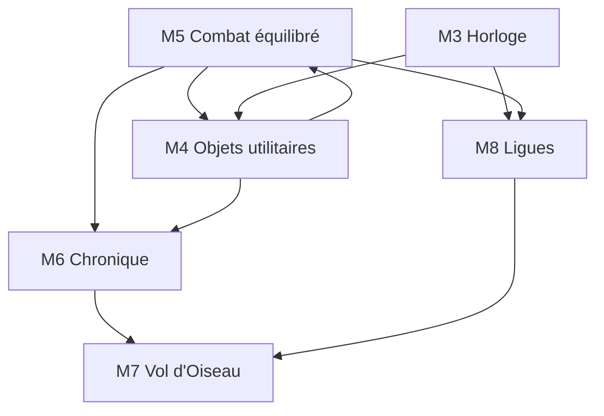

# 🔭 Milestone 9 : Feuille de Route Vivante & Points de Vigilance

Ce document **n'est pas une feature à livrer en un bloc**. Il centralise tout ce qui a émergé des discussions de design et d'implémentation : priorités restantes, sujets à surveiller, dettes connues, et idées volontairement mises en attente.

**Mise à jour :** à enrichir à chaque session de design ou PR significative.

---

## 🧭 Principes de design validés (ne pas régresser)

Ces règles ont été posées explicitement et doivent guider les prochains milestones :

| Principe | Implication |
| :--- | :--- |
| **Équilibrer avant d'empiler** | Le moteur M5 a été calibré avant M4 (objets). Ne pas ajouter de bonus plats par-dessus. |
| **Ryos = gestion du club** | Dispensaire, salaires, examens, dojo — le Marché est un **complément**, pas la seule sink. |
| **Objets = utilitaires uniquement** | Pas d'armes/armures +stats. Catégories **bureau / match / cycle**. Voir [`m4-utility-items-catalog.md`](./m4-utility-items-catalog.md). |
| **Match = mécaniques, pas power creep** | Fumigène (−50 % fatal), rupture genjutsu, leurres — pas de +2 Taijutsu. |
| **1 slot par ninja** | Match **ou** cycle ; objets bureau = bouton « Utiliser » sans équipement. |
| **Pas de compo dominante** | Cercle Assaut → Mur → Flux → Assaut (~60 % win par matchup). Équilibre (mixte) ≈ neutre. Voir [`composition-triangle.md`](./composition-triangle.md). |
| **Chronique découplée** | M6 lit les `combat_log` JSON ; le traducteur narratif s'enrichit sans toucher `combatEngine.js`. |
| **La variance doit raconter** | Upsets mémorables oui ; frustration RNG pure non. |

---

## ✅ Livré ou amorcé (référence rapide)

| Zone | Statut | Notes |
| :--- | :--- | :--- |
| M1 — Stats, clans, traits | ✅ | **Profils voie + potentiel** — spec [`ninja-profiles.md`](./ninja-profiles.md) |
| M2 — Bureau, escouade, router | ✅ | |
| M3 — Horloge 72h, jobs H36/H71/H72 | 🟡 | Scheduler 60s, outils `clock:advance` |
| M5 — Moteur combat 12 tours | 🟡 | Initiative probabiliste, lissage duels |
| M6 — Chronique `/operation` | 🟡 | Pipeline narratif ; **à réviser** quand objets enrichis |
| M8 — Pools, classement, calendrier | 🟡 | Bots, ligue UI, fin de saison cycle 10, `join_or_create_pool`, invite `invitePoolId` |
| Swap actifs ↔ banc | 🟡 | API + UI survol ; **styles à valider** |
| M4 — Marché, missions, équipement | 🟡 | PR en cours ; pivot utilitaire ; **progression grades** (plafonds + stagnation) |

---

## 🎯 Priorités suggérées (ordre actuel)

1. ~~**Refonte M4 simplifiée**~~ — ✅ migration 011, catalogue utilitaires, hooks match, `POST /inventory/use`
2. ~~**Polish UI profils**~~ — ✅ cartes ninja (voie, potentiel, lignée) · alertes stagnation Bureau
3. ~~**Fin M8**~~ — ✅ promotions/relégations cycle 10, `join_or_create_pool`, invitations `invitePoolId`
4. **Polish swap compo** — Validation UX des boutons au survol (position 50 %, icônes)
5. **Protect avec cible explicite** — Consigne Protect : désigner l'allié à couvrir (UI + moteur)
6. ~~**M7 — Vol d'Oiseau**~~ — ✅ inscription cérémonie, prime H72, relève Genin roturier, notifications Bureau
7. **Dispensaire** — Forme `Lamentable` : récupération entre cycles (mentionné M6 dénouement)
8. **M6 enrichi** — Phrases objets match, interception Sensei dans la chronique

---

## 👁️ Points de vigilance (équilibrage & simulations)

À re-mesurer après chaque changement combat / objets / tactiques.

### Profil de référence (sans équipement)

Simulation démo vs bot (~**+40 %** puissance brute côté démo) — `npm run combat:benchmark` (800 runs, juil. 2026) :

| Métrique | Valeur observée | Cible indicative |
| :--- | :--- | :--- |
| Victoire favori (+40 % stats) | ~**60 %** | Compétence compte, pas scripté |
| Nuls (favori vs standard) | ~**29–32 %** | Acceptable pour du manager |
| Upsets (underdog sans tactique) | ~**8–11 %** | Mémorables sans frustrer |
| Upsets (underdog + Off/Tank/Protect) | ~**29 %** | La tactique compense le gap |
| K.O. | ~**0 %** | Sur 12 tours ; surveiller si objets augmentent |
| Tours moyens | **12** | Matchs souvent aux points |

**Équipes symétriques :** home ~43 % / away ~46 % / nuls ~12 % — proche du 50/50.

**Multi-cycle (20 cycles, entraînement actif) :** combat total passe ~81 → ~99 (Genin) ; progression lente mais visible. Underdog vs bot +40 % : home ~15 % win, ~35 % nuls sur 20 cycles.

**Tactiques vs stats :** underdog standard vs bot +40 % → **8 %** win ; avec Off/Tank/Protect → **29 %** win (−30 pts de gap stats largement comblés).

### Impact des objets (cible après pivot utilitaire)

| Scénario | Impact win rate | Interprétation |
| :--- | :--- | :--- |
| Objet sans plan (ex. fumée en Tank) | **≈ 0 à +2 pts** | ✅ Comportement voulu |
| Objet + consigne cohérente | **+4 à +8 pts** | Ouverture / leurre / tempo préparés |
| Double utilitaire optimisé | **≤ +12 pts** plafond | Ne doit pas écraser la tactique pure |

*Ancien catalogue armes/armures : sims ~0–2 pts sans consigne — conservé comme référence jusqu’à migration 009.*

**Tactiques vs objets**

- Changer les consignes peut **bouger le win rate de ±20–30 pts** selon le matchup de composition — la tactique compte, mais **aucune compo ne doit gagner > 70 %** contre une autre.
- Le trio Off/Tank/Protect est une escouade **équilibrée** (hors cercle), pas une meta dominante.
- **À surveiller :** matchups Flux vs Assaut génèrent beaucoup de nuls (~45 %) — acceptable pour du manager, à valider en playtest.

### Métriques `combat:benchmark` (implémenté)

```
- win% / draw% / loss% (favori vs underdog)
- upset rate (underdog win)
- KO rate, ending_tour moyen
- consommables déclenchés / match
- procs armes épuisés avant fin de match (%)
- écart win% avec vs sans équipement (même compo)
```

---

## 🔧 Revue technique & dette connue

| Sujet | Détail | Action |
| :--- | :--- | :--- |
| **M6 ↔ M4** | La chronique ne mentionne pas encore les objets utilisés en match | Enrichir `phraseDictionary` + templates interception/objet |
| **M6 ↔ futur** | Spécialisations, dispensaire, Protect ciblé changeront les logs | Garder M6 comme couche traduction, pas de texte dans M5 |
| **Équipement en BDD** | Seed démo sans objets équipés → sims = sans M4 en pratique | Seed optionnel ou scénario benchmark avec loadout |
| **README roadmap** | Statuts milestones pas à jour | Aligner avec l'état réel des PR |
| **WebSocket `/operation`** | Optionnel dans spec M6 | Polling 30s suffit pour l'instant |
| **Bots** | `is_bot` : pas d'entraînement, pas de marché | Cohérent ; ne pas leur donner d'objets sans réfléchir |

---

## 🔍 Revue design à planifier (décision PO requise)

Points soulevés en session — **ne pas implémenter sans arbitrage** :

| Sujet | Question ouverte | État actuel |
| :--- | :--- | :--- |
| **Missions idle** | Règles, coûts Ryos, blocages équipement, durée vs récompense, affichage Bureau | Missions résolues à H72 ; design global à revoir |
| **Entraînement par ninja (Ryos)** | **Décision PO :** seuls les ninjas pour lesquels le joueur a **explicitement choisi** un plan d'entraînement (stat ciblée) sont entraînés et facturés. Pas de focus dojo global implicite. **Bureau :** toujours afficher le détail des dépenses prévues / réalisées (par ninja, total cycle, solde après H72). **Déficit :** voir § Sanctions déficit ci-dessous. | Focus **dojo** unique (`sensei.training_focus`) ; entraînement **gratuit** ; `applyTrainingForUser` touche **tous** les ninjas sans filtre |

### Entraînement payant — principes validés (session design)

| Principe | Détail |
| :--- | :--- |
| **Périmètre** | Opt-in **par ninja** : pas d'entraînement ni de coût sans choix explicite pour ce cycle |
| **Facturation** | Prélèvement Ryos à **H72** (après calcul des gains, ou avant — à trancher à l'implémentation) |
| **Transparence Bureau** | Panneau « Budget du cycle » : ligne par ninja entraîné, coût unitaire, sous-total entraînement, salaires, examens, **solde projeté** |
| **Sink Ryos** | Rendre l'entraînement massif coûteux ; laisser un ninja sans plan = 0 Ryos (choix tactique) |

### Sanctions déficit — options à arbitrer (inspiré Hattrick, adapté manager 72 h)

**Référence [Hattrick](https://wiki.hattrick.org/wiki/Bankruptcy) :** pas de frais d'entraînement direct par joueur — le coût est **indirect** via les **salaires** qui montent avec le niveau. Déficit autorisé jusqu'à une **ligne de crédit** (~500 k€), **intérêts hebdomadaires** (~3,33 % sur la dette), **restrictions** avant faillite (achats joueurs / staff gelés), **avertissement** puis **faillite** (perte de l'équipe) si non résorbé en 2 semaines. Page **Finances** très détaillée (revenus / dépenses ligne par ligne).

**Pistes Kage Legacy** (moins brutal qu'une faillite — cycle 72 h, club plus petit) :

| Niveau | Piste | Effet gameplay |
| :--- | :--- | :--- |
| **A — Strict** | Pas de déficit : Ryos ≥ 0 toujours | Ninjas non payés **ne gagnent pas** leur session d'entraînement ce cycle (comme l'examen Chunin sans Ryos) |
| **B — Souple** | Petit découvert autorisé (ex. −5 000 Ryos max) | Intérêts à H72 : `3 % × dette` (sink, pression sans game over) |
| **C — Gel administratif** | Dette &gt; 0 après H72 | Bloquer : marché, examen Chunin, missions payantes — jusqu'à retour positif |
| **D — Pénalité club** | Dette non résorbée 2 cycles | Tous les ninjas : forme −1 palier + moral −3 (dojo en difficulté) |
| **E — Alerte seule** | Première version minimaliste | Bandeau rouge Bureau + pas d'entraînement des ninjas non couverts |

**Recommandation indicative :** **A + B léger** (pas de gain sans paiement ; petit découvert avec intérêts) + **transparence Bureau obligatoire** — proche de l'esprit Hattrick sans supprimer le compte.

**Décision PO (session juil. 2026) :**

| Point | Choix retenu |
| :--- | :--- |
| **Ordre H72** | **1. Salaires** → **2. Entraînement** (puis reste du batch : ligue, Vol d'Oiseau, stagnation, etc.) |
| **Modèle déficit** | **Souple** : petit découvert autorisé ; intérêts sur dette à H72 ; ninjas non couverts = pas de gain |
| **Plafond découvert** | À calibrer (indicatif **−5 000 Ryos** — à valider en playtest) |
| **Taux intérêt** | À calibrer (indicatif **3 % × dette** par cycle — miroir Hattrick à l'échelle 72 h) |

---

## 💤 Mis en attente (volontairement)

Idées discutées mais **reportées** pour ne pas diluer le gameplay :

| Idée | Pourquoi attendre |
| :--- | :--- |
| **Spécialisations Taijutsu / Ninjutsu / Genjutsu** | Multiplie la complexité ; préférer des **postures** légères ou nouvelles consignes |
| **Limite de stock inventaire** | Non retenu : la bonne limite est l'**usage par match**, pas le hoarding |
| **Armes / armures permanentes** | Remplacées par utilitaires ; voir pivot M4 |
| **Bonus stats objets en combat** | Rejeté ; Ryos → infrastructure + cycle |

---

## 📋 Backlog UI / UX (hors moteur)

- [ ] Valider styles swap : boutons 50 % sur carte, rotation icône, mobile (tap-to-swap)
- [ ] Bandeau Bureau « Opération en cours » → lien `/operation` (spec M2)
- [ ] Afficher les **utilisations restantes** en match dans le rapport M6 (panneau tactique optionnel)
- [ ] Marché : rappel « expire à H72 » plus visible
- [ ] **Budget du cycle (Bureau)** — détail dépenses prévues H72 : entraînement par ninja, salaires, examens, solde projeté

---

## 📋 Backlog gameplay (moteur & API)

- [ ] Protect : cible désignée (`protect_target_ninja_id`)
- [x] M8 : script fin de saison (cycles 10, promotions, relégations, archivage pools 100 % bots)
- [x] M8 : `join_or_create_pool` + inscription par invitation (`invitePoolId`, `GET /api/league/invite`)
- [ ] **Marché aspirants** — 1 recrutement payant / cycle, rareté noble — [`recruitment-market.md`](./recruitment-market.md)
- [ ] **Entraînement par ninja + coût Ryos (H72)** — opt-in par ninja, budget détaillé Bureau, sanctions déficit (voir revue design)
- [ ] Dispensaire (forme, coût Ryos ?)
- [x] UI alerte stagnation Chunin (combat ≥ 17)
- [x] `npm run combat:benchmark` — `backend/scripts/simulateCycles.js` ✅ (voir résultats ci-dessus)
- [ ] Narration : phrases pour `sensei_interception`, objet consommé, proc arme épuisée
- [ ] Débriefing M6 : alerte si objets équipés mais 0 proc (mauvaise consigne)

---

## 🔗 Dépendances entre milestones



**Règle :** toute feature qui modifie `combat_log` doit déclencher une passe sur M6 (traducteur + débriefing), pas une réécriture du moteur.

---

## 🛠️ Instructions pour le dev

* [ ] Consulter ce fichier **avant** d'ouvrir une PR qui touche combat, économie, tactiques ou chronique.
* [x] Après un changement d'équilibre : lancer `npm run combat:benchmark` et noter les résultats dans ce document.
* [ ] Cocher / déplacer les items vers « Livré » quand mergés.
* [ ] Ne pas traiter ce fichier comme une spec figée : c'est la **mémoire du projet**.
