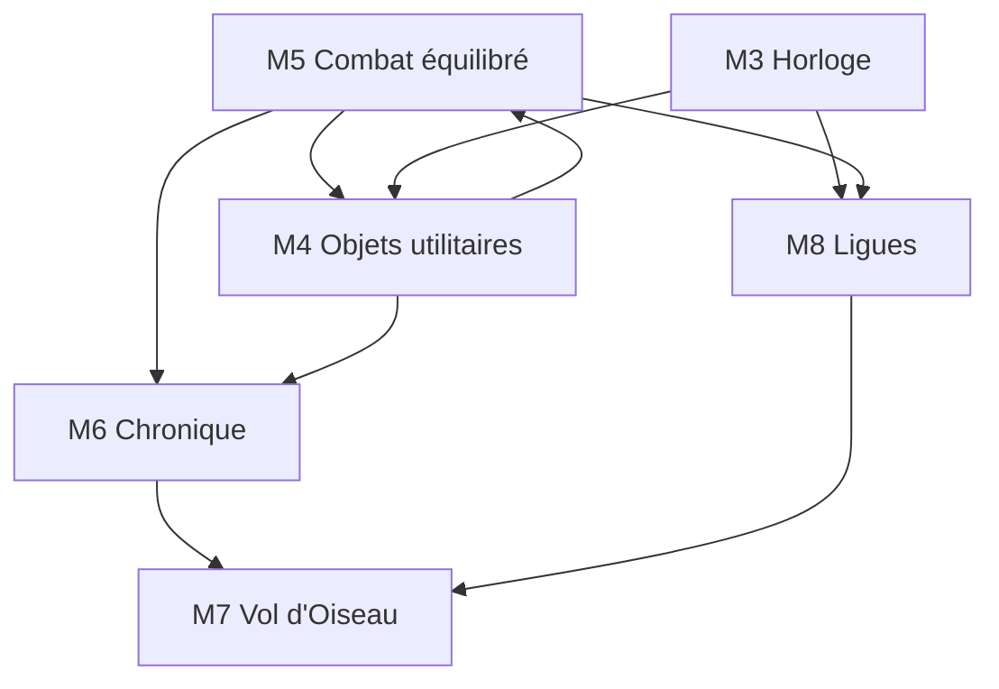

# 🔭 Milestone 9 : Feuille de Route Vivante & Points de Vigilance

Ce document **n'est pas une feature à livrer en un bloc**. Il centralise tout ce qui a émergé des discussions de design et d'implémentation : priorités restantes, sujets à surveiller, dettes connues, et idées volontairement mises en attente.

**Mise à jour :** à enrichir à chaque session de design ou PR significative.

---

## 🧭 Principes de design validés (ne pas régresser)

Ces règles ont été posées explicitement et doivent guider les prochains milestones :

| Principe | Implication |
| :--- | :--- |
| **Équilibrer avant d'empiler** | Le moteur M5 a été calibré avant M4 (objets). Ne pas ajouter de bonus plats par-dessus. |
| **Ryos = gestion du club** | Dispensaire, salaires, examens, dojo — le Marché est un **complément**, pas la seule sink. |
| **Objets = utilitaires uniquement** | Pas d'armes/armures +stats. Catégories **bureau / match / cycle**. Voir [`m4-utility-items-catalog.md`](./m4-utility-items-catalog.md). |
| **Match = mécaniques, pas power creep** | Fumigène (−50 % fatal), rupture genjutsu, leurres — pas de +2 Taijutsu. |
| **1 slot par ninja** | Match **ou** cycle ; objets bureau = bouton « Utiliser » sans équipement. |
| **3–4 leviers actifs / cycle** | Entraînement, tactique, 1 achat ciblé, compo — au-delà, fatigue cognitive. |
| **Chronique découplée** | M6 lit les `combat_log` JSON ; le traducteur narratif s'enrichit sans toucher `combatEngine.js`. |
| **La variance doit raconter** | Upsets mémorables oui ; frustration RNG pure non. |

---

## ✅ Livré ou amorcé (référence rapide)

| Zone | Statut | Notes |
| :--- | :--- | :--- |
| M1 — Stats, clans, traits | ✅ | Socle identité procédurale |
| M2 — Bureau, escouade, router | ✅ | |
| M3 — Horloge 72h, jobs H36/H71/H72 | 🟡 | Scheduler 60s, outils `clock:advance` |
| M5 — Moteur combat 12 tours | 🟡 | Initiative probabiliste, lissage duels |
| M6 — Chronique `/operation` | 🟡 | Pipeline narratif ; **à réviser** quand objets enrichis |
| M8 — Pools, classement, calendrier | 🟡 | Bots, ligue UI ; **promotions/relégations manquantes** |
| Swap actifs ↔ banc | 🟡 | API + UI survol ; **styles à valider** |
| M4 — Marché, missions, équipement | 🟡 | PR en cours ; **pivot catalogue utilitaire** à implémenter (spec catalogue prête) |

---

## 🎯 Priorités suggérées (ordre actuel)

1. **Refonte M4 simplifiée** — Supprimer gear/weapon/armor ; catalogue bureau+match+cycle ; migration 009 ; `POST /inventory/use`
2. **Fin M8** — Promotions / relégations cycle 10, `join_or_create_pool`, invitations `invitePoolId`
2. **Polish swap compo** — Validation UX des boutons au survol (position 50 %, icônes)
3. **M6 enrichi** — Mention des objets dans le dictionnaire narratif + débriefing (faille élémentaire → marché)
4. **Protect avec cible explicite** — Consigne Protect : désigner l'allié à couvrir (UI + moteur)
5. **Script `combat:benchmark`** — Rejouer les courbes win%/nul%/upset après chaque changement d'équilibre
6. **M7 — Vol d'Oiseau** — Retraite Chunin 20/20, relève Genin, prime Ryos / réputation
7. **Dispensaire** — Forme `Lamentable` : récupération entre cycles (mentionné M6 dénouement)

---

## 👁️ Points de vigilance (équilibrage & simulations)

À re-mesurer après chaque changement combat / objets / tactiques.

### Profil de référence (sans équipement)

Simulation démo vs bot (~**+40 %** puissance brute côté démo) :

| Métrique | Valeur observée | Cible indicative |
| :--- | :--- | :--- |
| Victoire favori | ~**63–65 %** | Compétence compte, pas scripté |
| Nuls | ~**30–33 %** | Acceptable pour du manager |
| Upsets (défaite favori) | ~**4–5 %** | Mémorables sans frustrer |
| K.O. | ~**0 %** | Sur 12 tours ; surveiller si objets augmentent |
| Tours moyens | **12** | Matchs souvent aux points |

### Impact des objets (cible après pivot utilitaire)

| Scénario | Impact win rate | Interprétation |
| :--- | :--- | :--- |
| Objet sans plan (ex. fumée en Tank) | **≈ 0 à +2 pts** | ✅ Comportement voulu |
| Objet + consigne cohérente | **+4 à +8 pts** | Ouverture / leurre / tempo préparés |
| Double utilitaire optimisé | **≤ +12 pts** plafond | Ne doit pas écraser la tactique pure |

*Ancien catalogue armes/armures : sims ~0–2 pts sans consigne — conservé comme référence jusqu’à migration 009.*

### Tactiques vs objets

- Changer les consignes (ex. Normal → Off/Tank/Off) peut **bouger le win rate de ±30 pts** selon la compo et l'adversaire — **bien plus** que les objets seuls.
- **À surveiller :** le tutoriel / débriefing doit expliquer que l'objet sans la bonne consigne ne sert à rien.

### Métriques à intégrer dans `combat:benchmark` (à créer)

```
- win% / draw% / loss% (favori vs underdog)
- upset rate (underdog win)
- KO rate, ending_tour moyen
- consommables déclenchés / match
- procs armes épuisés avant fin de match (%)
- écart win% avec vs sans équipement (même compo)
```

---

## 🔧 Revue technique & dette connue

| Sujet | Détail | Action |
| :--- | :--- | :--- |
| **M6 ↔ M4** | La chronique ne mentionne pas encore les objets utilisés en match | Enrichir `phraseDictionary` + templates interception/objet |
| **M6 ↔ futur** | Spécialisations, dispensaire, Protect ciblé changeront les logs | Garder M6 comme couche traduction, pas de texte dans M5 |
| **Équipement en BDD** | Seed démo sans objets équipés → sims = sans M4 en pratique | Seed optionnel ou scénario benchmark avec loadout |
| **README roadmap** | Statuts milestones pas à jour | Aligner avec l'état réel des PR |
| **WebSocket `/operation`** | Optionnel dans spec M6 | Polling 30s suffit pour l'instant |
| **Bots** | `is_bot` : pas d'entraînement, pas de marché | Cohérent ; ne pas leur donner d'objets sans réfléchir |

---

## 💤 Mis en attente (volontairement)

Idées discutées mais **reportées** pour ne pas diluer le gameplay :

| Idée | Pourquoi attendre |
| :--- | :--- |
| **Spécialisations Taijutsu / Ninjutsu / Genjutsu** | Multiplie la complexité ; préférer des **postures** légères ou nouvelles consignes |
| **Limite de stock inventaire** | Non retenu : la bonne limite est l'**usage par match**, pas le hoarding |
| **Armes / armures permanentes** | Remplacées par utilitaires ; voir pivot M4 |
| **Bonus stats objets en combat** | Rejeté ; Ryos → infrastructure + cycle |

---

## 📋 Backlog UI / UX (hors moteur)

- [ ] Valider styles swap : boutons 50 % sur carte, rotation icône, mobile (tap-to-swap)
- [ ] Bandeau Bureau « Opération en cours » → lien `/operation` (spec M2)
- [ ] Afficher les **utilisations restantes** en match dans le rapport M6 (panneau tactique optionnel)
- [ ] Marché : rappel « expire à H72 » plus visible
- [ ] Missions idle : afficher prérequis Rang C/B sur le Bureau

---

## 📋 Backlog gameplay (moteur & API)

- [ ] Protect : cible désignée (`protect_target_ninja_id`)
- [ ] M8 : script fin de saison (cycles 10, promotions, relégations, archivage pools 100 % bots)
- [ ] M8 : `join_or_create_pool` + inscription par invitation
- [ ] M7 : Vol d'Oiseau (H72 post-résultats)
- [ ] Dispensaire (forme, coût Ryos ?)
- [ ] `npm run combat:benchmark` — script de régression d'équilibre
- [ ] Narration : phrases pour `sensei_interception`, objet consommé, proc arme épuisée
- [ ] Débriefing M6 : alerte si objets équipés mais 0 proc (mauvaise consigne)

---

## 🔗 Dépendances entre milestones



**Règle :** toute feature qui modifie `combat_log` doit déclencher une passe sur M6 (traducteur + débriefing), pas une réécriture du moteur.

---

## 🛠️ Instructions pour le dev

* [ ] Consulter ce fichier **avant** d'ouvrir une PR qui touche combat, économie, tactiques ou chronique.
* [ ] Après un changement d'équilibre : lancer (ou créer) `combat:benchmark` et noter les résultats dans ce document.
* [ ] Cocher / déplacer les items vers « Livré » quand mergés.
* [ ] Ne pas traiter ce fichier comme une spec figée : c'est la **mémoire du projet**.
