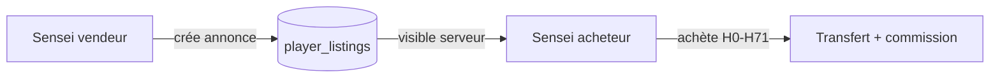

# 🤝 Marché entre joueurs (vision)

**Statut :** **V2 livrée** (objets + ninjas banc) — juil. 2026.

**Besoin :** un lieu où les Sensei **vendent et achètent** entre eux — distinct de l'**Académie** (tirage PNJ) et du **Magasin du village** (catalogue serveur).

---

## Principes directeurs

| Principe | Détail |
| :--- | :--- |
| **Joueur ↔ joueur** | Les annonces sont créées par un Sensei ; un autre Sensei achète |
| **Asynchrone 72 h** | Pas d'enchères temps réel obligatoires — annonces valables tout le cycle (ou jusqu'à vente) |
| **Périmètre** | **Marché global** — tous les joueurs humains du serveur ; la **ligue** reste le cadre compétitif (matchs, classement) |
| **Pas de pay-to-win sauvage** | Limiter ce qui est vendable (voir § Périmètre des biens) |
| **Commission sink** | Prélèvement Ryos à la vente (ex. 5–10 %) — sink économique + anti-flip |

---

## Périmètre des biens (à trancher)

| Bien | V1 suggérée | Risque |
| :--- | :--- | :--- |
| **Objets inventaire** (`user_items` non équipés) | ✅ Oui | Faible |
| **Ninja banc** (hors escouade active, pas inscrit examen) | ✅ Oui | Moyen — licenciement + revente |
| **Ninjas actifs** | ❌ Non | Doit d'abord être retiré de l'escouade |
| **Ryos directs** | ❌ Non | RMT / blanchiment |
| **Nobles** | ✅ Oui mais taxe plus haute | Évite inflation noble |

---

## Flux utilisateur (V1 proposée)



1. **Créer une annonce** — objet ou ninja banc, prix fixe en Ryos
2. **Voir les annonces** — onglet « Échanges » (marché global), tri par prix / type
3. **Acheter** — vérification Ryos, transfert immédiat, commission prélevée au vendeur
4. **Annuler** — vendeur retire son annonce (objet / ninja revient disponible)

**Fenêtre d'achat :** H0–H71 (gel à l'opération), comme les tactiques — à valider.

---

## Schéma BDD (ébauche)

```sql
player_listings (
  id, pool_id, seller_user_id,
  listing_type ENUM('item', 'ninja'),
  user_item_id NULL, ninja_id NULL,
  price INT UNSIGNED,
  status ENUM('active', 'sold', 'cancelled'),
  buyer_user_id NULL,
  created_at, sold_at
)
```

- Une annonce = **un** bien
- Index par `pool_id` + `status`
- Historique des ventes pour transparence Bureau (optionnel)

---

## Équilibrage économique

| Levier | Piste |
| :--- | :--- |
| **Commission** | 5 % vendeur + 0 % acheteur (ou 2 % des deux) |
| **Plafond annonces** | 3 annonces actives / Sensei / cycle |
| **Prix plancher / plafond** | Objet : 50 %–200 % prix catalogue ; **ninja : prix libre** (choix du vendeur) |
| **Cooldown** | Ninja revendu : moral −3 premier cycle chez le nouvel employeur |
| **Bots** | N'achètent pas ; peuvent **vendre** des objets génériques si pool 100 % bots remplacé — basse priorité |

---

## UI

| Écran | Contenu |
| :--- | :--- |
| **Marché** (nav `/exchanges`) | Annonces P2P globales + « Mes annonces » + historique |
| **Magasin** (nav actuelle `/market`) | Catalogue village — 3 articles / cycle (M4) |
| **Bureau** | Lien rapide vers le marché joueurs ; **pas** l'Académie |
| **Inventaire / fiche ninja** | Bouton « Mettre en vente » si éligible |

---

## Ordre d'implémentation suggéré

1. Objets seuls (plus simple — pas de transfert de ninja)
2. Ninjas banc + garde-fous (examen, mission idle)
3. Historique + notifications (« votre annonce a été achetée ») — ✅
4. ~~Extension inter-pools~~ — **non retenu** : marché global par défaut (ligue = compétitif uniquement)

---

## Dépendances

- Pools / ligue actifs (M8) ✅
- Économie Ryos stable (salaires, entraînement) 🟡
- Académie et **Magasin du village** nommés distinctement — voir [`academy.md`](./academy.md), [`m4-utility-items-catalog.md`](./m4-utility-items-catalog.md)
